# graphty brand guide

This is the official brand kit of [graphty](https://github.com/graphty-org): the logos, colors,
type and rules for using them. The logos may be used under the [logo usage terms](LICENSE.md);
read them before using a logo outside the graphty project. The Outfit font in [fonts/](fonts/) has
its own license, the SIL Open Font License 1.1 ([fonts/OFL.txt](fonts/OFL.txt)).

This guide says how to use the graphty logo, colors and type, and which file in this repository to
use for each job. Every logo file here is final artwork: use it as it is, and never redraw it.

## The brand

graphty is a family of open-source tools for working with graphs on the web: a web component that
draws them and libraries for layouts, algorithms and graph files. The brand is precise, technical
and friendly: a calm ink system with one bright lime signal. The logo is a small graph that spells
the name, and its single lime node is the one thing that lights up, the way a selected node does in
a graph tool.

## The logo


The logo has two parts.

- **The mark** is a lowercase "g" drawn as a graph: two ring nodes (the bowl and the loop) joined by
  an edge, and an edge out to a solid accent node at the top right. The accent node is lime
  (`#97c800` on white, `#c4f23a` on dark); everything else is ink.
- **The wordmark** is the word "graphty" in Outfit Medium (500) with stylistic set 1 (`ss01`),
  Outfit's single-storey "g". In every logo file the letters are outlines, so no font is needed to
  show them.

## Lockups

A lockup is a fixed arrangement of the mark and the wordmark. Never assemble one yourself: use the
files.

| Lockup     | Preview                                                                                           | Use it for                                                                                      |
| ---------- | ------------------------------------------------------------------------------------------------- | ----------------------------------------------------------------------------------------------- |
| Horizontal |    | The default: site headers, READMEs, slides, documents, anywhere there is more width than height |
| Stacked    | 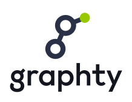 | Square or tall spaces: title slides, posters, stickers, profile cards                           |
| Mark       |                           | Small or square places: favicons, avatars, app icons, and anywhere the name is already shown    |
| Wordmark   | 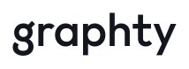            | Only where the mark already appears nearby, such as a footer under a large mark                 |

Each lockup comes in four versions:

- **color-on-light**: for white and light backgrounds.
- **color-on-dark**: for black and dark backgrounds, from `#111111` up to the ink `#2a3045`.
- **white**: one color, for dark or colored backgrounds and photos where the color version does not
  stand out, and for one-color printing on dark stock.
- **black**: one color, for one-color printing, engraving and embossing.

## Clear space and minimum size

The unit of measure is **n**, the diameter of the accent node: about one fifth of the mark's
height. Keep at least **1 n** of empty space on every side of the mark or any lockup. Nothing
(text, other logos, the edge of a card or screen) may enter it.

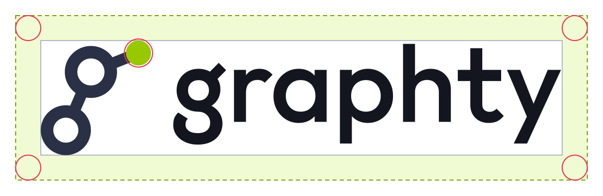

| Artwork                   | Smallest on screen      | Smallest in print |
| ------------------------- | ----------------------- | ----------------- |
| Mark                      | 16 px tall              | 5 mm tall         |
| Horizontal lockup         | 20 px tall (80 px wide) | 25 mm wide        |
| Stacked lockup            | 48 px wide              | 15 mm wide        |
| Package lockup            | 24 px tall              | 8 mm tall         |
| Package mark              | 24 px tall              | 8 mm tall         |
| Cytoscape co-brand lockup | 24 px tall              | 8 mm tall         |

Below 24 px, use the plain graphty mark instead of a package mark.

## Color

The palette is lime and ink. Lime is the signal: it marks the one thing that matters on a surface.
Ink carries everything else. The tokens are in [colors/tokens.json](colors/tokens.json) and
[colors/tokens.css](colors/tokens.css); the palette sheet is
[colors/palette.svg](colors/palette.svg) ([PNG](colors/palette.png)).

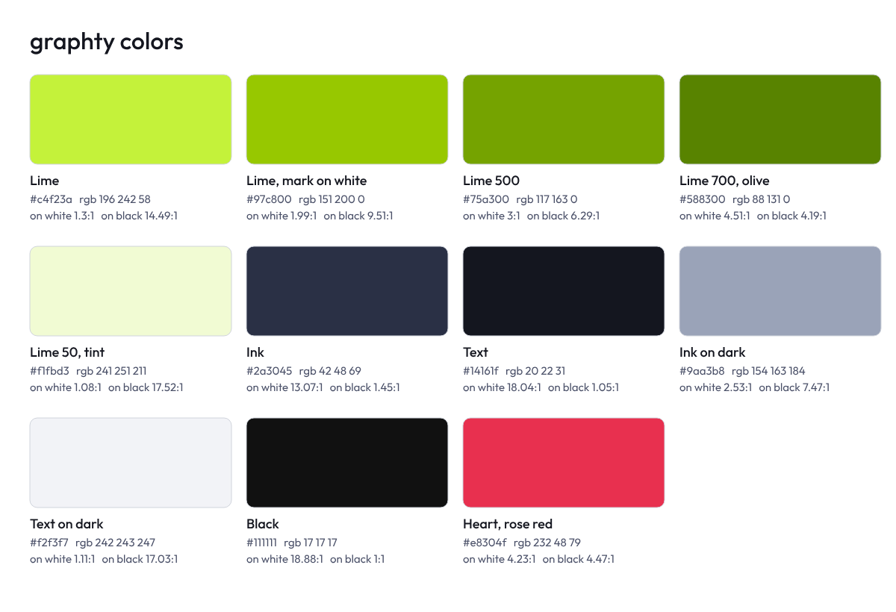

Contrast is the WCAG 2.x ratio. Text needs 4.5:1 (3:1 at 24 px and up, or 19 px bold); a graphic
that carries meaning needs 3:1. The logo artwork is exempt from both.

| Color               | Hex       | RGB           | HSL           | On white | On `#111111` |
| ------------------- | --------- | ------------- | ------------- | -------- | ------------ |
| Lime                | `#c4f23a` | 196, 242, 58  | 75, 88%, 59%  | 1.3:1    | 14.49:1      |
| Lime, mark on white | `#97c800` | 151, 200, 0   | 75, 100%, 39% | 1.99:1   | 9.51:1       |
| Lime 500            | `#75a300` | 117, 163, 0   | 77, 100%, 32% | 3:1      | 6.29:1       |
| Lime 700, olive     | `#588300` | 88, 131, 0    | 80, 100%, 26% | 4.51:1   | 4.19:1       |
| Lime 50, tint       | `#f1fbd3` | 241, 251, 211 | 75, 83%, 91%  | 1.08:1   | 17.52:1      |
| Ink                 | `#2a3045` | 42, 48, 69    | 227, 24%, 22% | 13.07:1  | 1.45:1       |
| Text                | `#14161f` | 20, 22, 31    | 229, 22%, 10% | 18.04:1  | 1.05:1       |
| Ink on dark         | `#9aa3b8` | 154, 163, 184 | 222, 17%, 66% | 2.53:1   | 7.47:1       |
| Text on dark        | `#f2f3f7` | 242, 243, 247 | 228, 24%, 96% | 1.11:1   | 17.03:1      |
| Black               | `#111111` | 17, 17, 17    | 0, 0%, 7%     | 18.88:1  | 1:1          |
| Heart, rose red     | `#e8304f` | 232, 48, 79   | 350, 80%, 55% | 4.23:1   | 4.47:1       |

### Rules for lime

- **On dark, use the bright lime `#c4f23a`** for everything: the mark's node, accent fills and
  accent text.
- **On white, bright lime is never text and never a thin line.**
    - The logo artwork on white uses `#97c800`: the mark's node, and the package names in the
      package lockups, the package wordmarks and the co-brand lockup. Nothing outside the logo
      files uses it for text.
    - Other green text on white (links, accent text at body size) is lime 700 `#588300`.
    - Thin graphics on white that must be seen (focus rings, selection outlines, a lone icon) are
      lime 500 `#75a300`.
    - Lime 50 `#f1fbd3` is a background tint only. Text on it is `#14161f`.
- **Labels on a lime fill are dark**, never white: `#14161f` on `#97c800`, `#111111` on
  `#c4f23a`. The one exception is a lime 700 `#588300` fill, which takes white labels.
- **Lime is for one thing at a time**: the selected, active or primary item. Never use it for large
  areas, decoration or body text.
- **The heart red `#e8304f` belongs to the Cytoscape co-brand only.** It is not an error color and
  not a second accent.

### Color in interfaces

Interfaces built on the brand, such as the graphty app, use these roles:

| Role                                 | Light theme                    | Dark theme                     |
| ------------------------------------ | ------------------------------ | ------------------------------ |
| Filled button, active tool           | `#97c800` with `#14161f` label | `#c4f23a` with `#111111` label |
| Accent text, links                   | `#588300`                      | `#c4f23a`                      |
| Focus ring, selection outline, icons | `#75a300`                      | `#c4f23a`                      |
| Selected-row background              | `#f1fbd3`                      | the panel's own raised gray    |

The same roles are in `theme.light` and `theme.dark` of [colors/tokens.json](colors/tokens.json).
Graph drawings use their own data palettes; never make the accent the only cue for a selection on a
graph whose groups are already colored green.

## Typography

| Use                         | Typeface                                      | Settings                                                     |
| --------------------------- | --------------------------------------------- | ------------------------------------------------------------ |
| The word "graphty" in logos | Outfit Medium (500)                           | Stylistic set 1 (`ss01`) on, default kerning, lowercase only |
| Package names in lockups    | Outfit Regular (400)                          | No stylistic set, lowercase, exactly as named on npm         |
| Headings and titles         | Outfit Medium (500)                           | No stylistic set, sentence case                              |
| Interface and body text     | Inter, falling back to the system UI font     |                                                              |
| Code                        | Roboto Mono, falling back to system monospace |                                                              |

The Outfit font file and its license are in [fonts/](fonts/README.md), with its weights, settings
and CSS. Outfit is under the SIL Open Font License 1.1: free to use, embed and ship, not to sell on
its own.

Never set the word "graphty" in another font next to the mark, and never type the wordmark: use a
logo file. In running text, write the name in lowercase: graphty, graphty-element, graph-io.

## Package brands

Each package has a lockup of three parts, in this order: its package mark (or the plain graphty
mark), the word "graphty" in Outfit Medium in the text color, and the package name in Outfit Regular
in the same green as the mark's node (`#97c800` on white, `#c4f23a` on dark). A package mark is the
graphty mark plus one detail that says what the package does.

| Package                 | Package mark                                    | Lockup                                                                                                                                           |
| ----------------------- | ----------------------------------------------- | ------------------------------------------------------------------------------------------------------------------------------------------------ |
| graphty-element         | the g between angle brackets: a web component   | 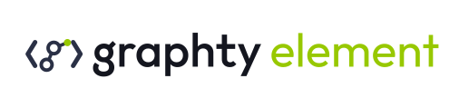                        |
| layout                  | the g in a selection box with four lime handles | 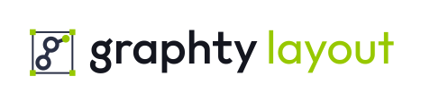                                           |
| algorithms              | a traced shortest path and a halo on the bowl   | 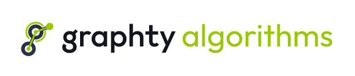                               |
| graph-io                | the g stepping out of a document page           | 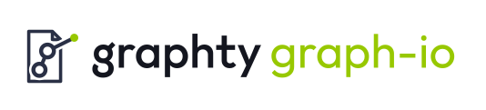                                     |
| graph-format            | the g between square brackets: an array         | 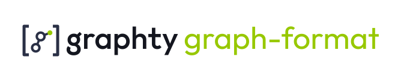                         |
| graph-samples           | the g on the front card of a stack of three     | 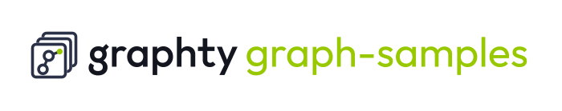                      |
| webgpu-graph-algorithms | the g on a chip with pins                       | 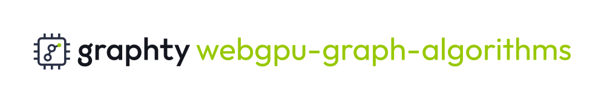         |
| cytoscape-extensions    | the plain graphty mark                          | 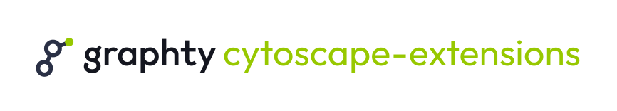 |

The graphty-element lockup reads "graphty element".

Rules for package brands:

- Keep the order and spacing of the files. Never drop "graphty" from a lockup.
- Package names stay exactly as they are spelled on npm, in lowercase, hyphens included.
- Use a package brand only for that package. The plain graphty logo represents the whole project.

## The Cytoscape co-brand

`@graphty/cytoscape-extensions` brings graphty's layouts and algorithms to Cytoscape.js. Its
co-brand is the graphty mark, a rose-red heart and the Cytoscape.js logo, read as "graphty loves
Cytoscape.js". It comes as a symbol and as a lockup with the package name, in color versions only:
`color-on-light` and `color-on-dark`. There are no white or black versions; where only one color
is possible, use the plain cytoscape-extensions lockup.

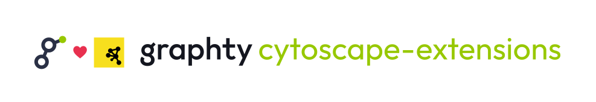

Rules:

- **The Cytoscape.js logo stays exactly as Cytoscape.js publishes it**: its yellow square and black
  drawing. Never recolor, crop, outline or redraw it.
- **The heart is rose red `#e8304f`**, never lime, pink or any other red.
- Keep the spacing of the files.
- Use the co-brand only to say that cytoscape-extensions works with Cytoscape.js, and always next
  to this statement: "cytoscape-extensions is made by the graphty project and is not affiliated
  with or endorsed by the Cytoscape Consortium." Where that statement cannot fit, use the plain
  cytoscape-extensions lockup.
- The Cytoscape.js logo belongs to the Cytoscape Consortium; the graphty [usage terms](LICENSE.md)
  grant nothing about it.

## Backgrounds and imagery

- The color logos go on white or on black and near-black (`#111111` to the ink `#2a3045`). On any
  other color, a photo or a gradient, use the white or black version, whichever contrasts more, and
  keep the area behind the logo calm.
- On a lime background use the black version; on the ink use the white or the color-on-dark one.
- Imagery shows real graphs: graphty-element renderings of real data sets, with nodes and edges
  clearly visible, ideally one highlighted element in lime against ink and gray.
- No stock photos of people at screens, abstract "network" glows, neon, lens flares or
  three-dimensional chrome. The brand is flat and precise.
- Social images use the text color `#14161f` as their background with the color-on-dark lockup;
  see `icons/social/`.

## Misuse

Do:

|  | 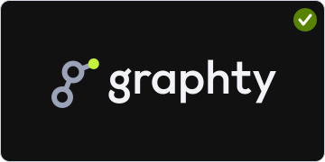 | 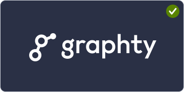 | 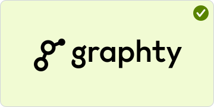 |
| ---------------------------------------- | -------------------------------------- | ------------------------------------------ | -------------------------------------------- |
| Color version on white                   | Color-on-dark version on black         | White version on the ink                   | Black version on the lime tint               |

Do not:

|        | 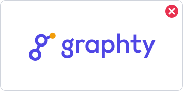          | 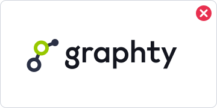 |               |
| ------------------------------------------ | --------------------------------------------- | ------------------------------------------- | ----------------------------------------------- |
| Stretch or squash it                       | Recolor it                                    | Move the lime to another circle             | Add an outline or a glow                        |
| 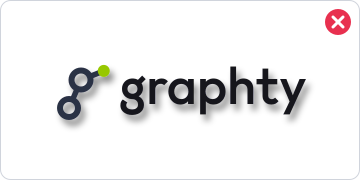           | 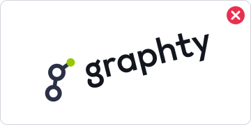             |      | 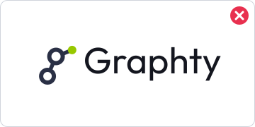       |
| Add a shadow or other effect               | Rotate or tilt it                             | Rearrange or resize the parts               | Retype the name in another font or case         |
|            |   | 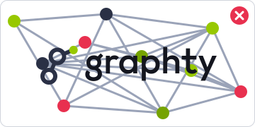     |  |
| Crowd it inside its clear space            | Put it on a mid-tone it cannot stand out from | Put it on a busy image                      | Set small text in bright lime on white          |
| 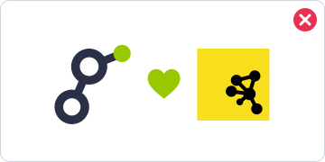 |                                               |                                             |                                                 |
| Change the heart's color in the co-brand   |                                               |                                             |                                                 |

## Files

Every logo comes as SVG (vector, preferred wherever it is accepted) and as transparent PNG. PNG
names end in their size: `-64.png` is 64 x 64 px, `-800w.png` is 800 px wide.

```
graphty-brand/
|-- README.md                this guide
|-- LICENSE.md               logo usage terms
|-- logo/
|   |-- mark/                the g alone; PNG 16 to 1024 px square
|   |-- lockup/horizontal/   mark + wordmark side by side (the default); PNG 200, 400, 800, 1600 px wide
|   |-- lockup/stacked/      mark above wordmark
|   `-- wordmark/            the word alone
|-- child-brands/<package>/  graphty-element, layout, algorithms, graph-io, graph-format,
|   |                        graph-samples, webgpu-graph-algorithms, cytoscape-extensions
|   |-- mark/                the package mark (packages that have one); PNG 16 to 512 px
|   |-- lockup/              package mark + "graphty" + package name
|   `-- wordmark/            "graphty" + package name, no mark
|-- co-brand/cytoscape/      color versions only
|   |-- symbol/              g, heart, Cytoscape.js logo
|   `-- lockup/              the symbol + "graphty cytoscape-extensions"
|-- icons/
|   |-- favicon/             favicon.ico (16, 32, 48), favicon.svg (adapts to dark mode), PNGs
|   |-- app/                 apple-touch-icon (180), android-chrome 192 and 512, maskable 192 and 512
|   `-- social/              Open Graph 1200 x 630, GitHub social preview 1280 x 640
|-- colors/                  palette sheet, tokens.json, tokens.css
|-- fonts/                   Outfit (variable TTF), its license OFL.txt, README.md
|-- guide/                   the diagrams in this guide
`-- design/                  how the brand was designed: the options considered, each design
                             round, and the scripts that build every file in this kit
```

Inside each logo folder the files are grouped as `svg/<version>/` and `png/<version>/`, where the
version is `color-on-light`, `color-on-dark`, `white` or `black`.

| I need...                              | Use                                                                                                             |
| -------------------------------------- | --------------------------------------------------------------------------------------------------------------- |
| The logo on a web page or in a README  | `logo/lockup/horizontal/svg/color-on-light/` (and `color-on-dark/` for dark mode)                               |
| A site favicon                         | `icons/favicon/favicon.svg` plus `icons/favicon/favicon.ico` as the fallback                                    |
| An iOS home-screen icon                | `icons/app/apple-touch-icon.png`                                                                                |
| A web app manifest icon                | `icons/app/android-chrome-192.png`, `-512.png`, and `maskable-192.png`, `-512.png` with `"purpose": "maskable"` |
| A link preview image                   | `icons/social/open-graph-1200x630.png`                                                                          |
| The GitHub repository social preview   | `icons/social/github-social-preview-1280x640.png`                                                               |
| An avatar (GitHub org, npm, chat)      | `logo/mark/png/color-on-light/graphty-mark-color-on-light-512.png`, or the app icon tile                        |
| A package README header                | `child-brands/<package>/lockup/svg/...`                                                                         |
| One-color print, engraving, embroidery | `logo/.../svg/black/` or `svg/white/`                                                                           |
| Colors in code                         | `colors/tokens.css` or `colors/tokens.json`                                                                     |
| The brand font                         | `fonts/Outfit-VariableFont_wght.ttf`                                                                            |

A favicon set in HTML:

```html
<link rel="icon" href="/favicon.ico" sizes="48x48" />
<link rel="icon" href="/favicon.svg" type="image/svg+xml" />
<link rel="apple-touch-icon" href="/apple-touch-icon.png" />
```

## Using the logos

The graphty name and logos belong to the graphty project
([graphty-org](https://github.com/graphty-org)). Anyone may use them to refer to graphty, its
packages and integrations with it, as long as they do not present graphty as their own, imply
endorsement or partnership, change the logos, or use them in their own brand, product name or
logo. The code's MIT License grants no rights to the name or logos. The full terms, and how to ask
for other uses, are in [LICENSE.md](LICENSE.md).
