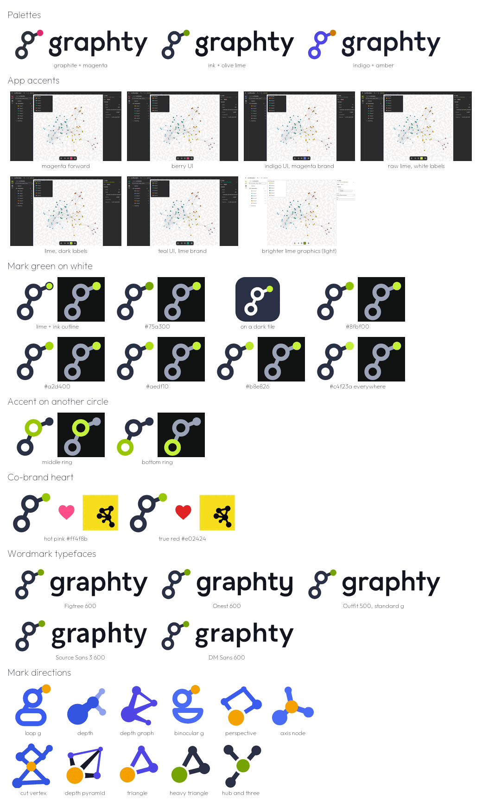
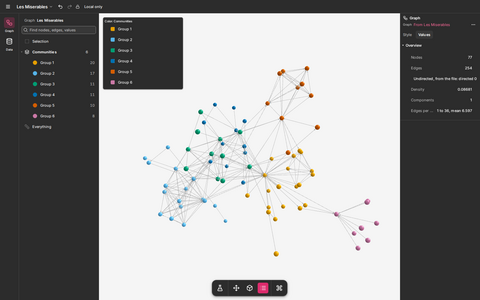
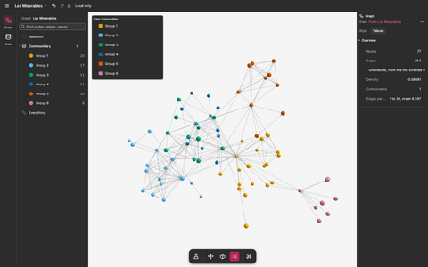
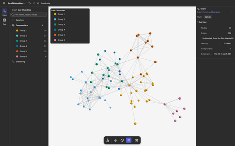
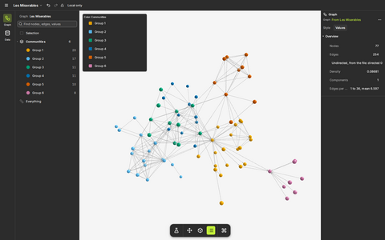
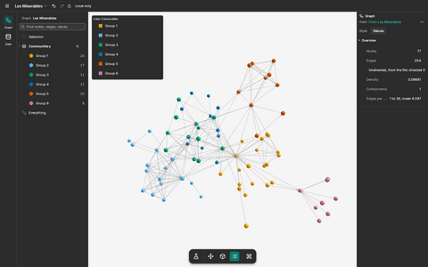
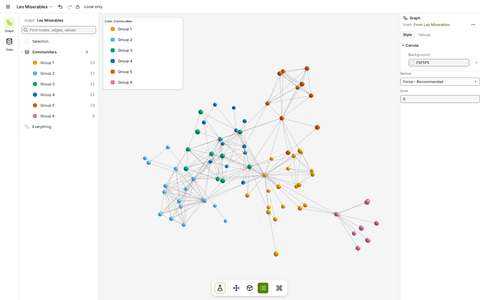

# graphty logo: options considered and set aside

A design record of the colors, marks, typefaces and details compared before the graphty brand was
settled. The brand itself, and how to use it, is in
[the brand guide](../README.md). Every option below appears, under the same
name, in one contact sheet, and as a larger image in its table. The design rounds that produced
them are in [rounds/](rounds/); the story of how the brand was reached is in [README.md](README.md).

This page is a short list of the strongest alternatives. Each section ends with a "Full set" line
pointing at the round page and folder that holds every option of that kind, in every color and
size, with the script that drew it. The editable SVG behind each image on this page is in
[explorations/src/](explorations/src/) where the kit build made one, and otherwise in the round
folder.

## Palettes

Ink `#2a3045` with lime was chosen. Its first version used a darker olive lime, later brightened to
the lime scale in the brand.

| Option                                    | Preview | Why it was set aside                                                                          |
| ----------------------------------------- | --- | --------------------------------------------------------------------------------------------- |
| graphite + magenta (`#2e323c`, `#dd2c6d`) |  | Strongest accent at 16 px, but less distinctive than lime among the many pink and red brands. |
| ink + olive lime (`#2a3045`, `#6f9c00`)   |  | The winning direction, but this olive read as dull and too dark.                              |
| indigo + amber (`#4f46e5`, `#c97c00`)     |  | Calm, but indigo is the most common color in developer tools; amber needs a darker step.      |

Full set: [rounds/round-2/palettes/](rounds/round-2/palettes/) (five palettes), [rounds/round-3/color/](rounds/round-3/color/) (six, with contrast and color-blindness checks), the full kit in magenta, lime and amber in [rounds/round-6/index.html](rounds/round-6/index.html), and the pros and cons in [rounds/round-5/index.html](rounds/round-5/index.html), section 8.

## App accents

Each candidate was tried as the graphty app's accent on the real app (Les Miserables, community
detection; dark theme unless noted). The final app accent grew out of "lime, dark labels".

| Option                         | Preview | Colors                                                             | Why it was set aside                                                         |
| ------------------------------ | --- | ------------------------------------------------------------------ | ---------------------------------------------------------------------------- |
| magenta forward                |  | `#dd2c6d`, hover `#c4245f`, text on dark `#f06592`, teal `#0ca678` | Worked well, but set aside with the pink direction; error red is close.      |
| berry UI                       |  | brand `#dd2c6d`, UI `#b8245c`, teal `#0f766e`                      | Heavier buttons on dark, even closer to error red.                           |
| indigo UI, magenta brand       |  | UI `#4f5fd9`, text on dark `#8e9bff`                               | The app no longer looks like the logo; indigo is generic.                    |
| raw lime, white labels         |  | `#c4f23a` with white labels                                        | Illegible: white on lime is 1.3:1. Showed that lime needs dark labels.       |
| lime, dark labels              |  | `#c4f23a` on dark, `#588300` on light, `#75a300` graphics          | Kept as the basis; its all-olive light theme was brightened to `#97c800`.    |
| teal UI, lime brand            |  | UI `#0b7a6f`, text on dark `#2dd4bf`                               | Success green gets lost between teal and lime; app stops matching the logo.  |
| brighter lime graphics (light) |  | `#8fbf00` for icons and selection, `#588300` for text              | Focus rings at 2.18:1 on white were too faint; thin graphics went `#75a300`. |

Full set: nine screens per accent in [rounds/round-7/app/](rounds/round-7/app/) and [rounds/round-8/app/](rounds/round-8/app/), side by side on [rounds/round-7/index.html](rounds/round-7/index.html); the theme change that produced them, to apply again, in [app-accent/](app-accent/README.md).

## Mark green on white

Bright lime `#c4f23a` nearly vanishes on white (1.3:1), so the mark's dot on white needed its own
green. `#97c800` was chosen: a solid dot that still holds at 16 px.

| Option               | Preview | Why it was set aside                                                 |
| -------------------- | --- | -------------------------------------------------------------------- |
| lime + ink outline   |  | At 16 px the outline and the lime blend into a gray-green dot.       |
| `#75a300`            |  | Exactly 3:1, but reads as olive, not lime.                           |
| on a dark tile       |  | Keeps lime on dark, but turns every white placement into a tile.     |
| `#8fbf00`            |  | Good, a step duller than `#97c800`; the brighter step was preferred. |
| `#a2d400`            |  | The dot starts to look lighter than the rings and softens at 16 px.  |
| `#aedf10`            |  | The dot turns pale; the ink rings carry the mark.                    |
| `#b8e826`            |  | Washed out, and very faint on a light gray tab bar.                  |
| `#c4f23a` everywhere |  | One value everywhere, but the faintest dot on white.                 |

Full set: G-W1 to G-W4 on [rounds/round-7/index.html](rounds/round-7/index.html), G-W4 to G-W9 on [rounds/round-8/index.html](rounds/round-8/index.html), and the package-name greens on [greens-check/index.html](greens-check/index.html).

## Accent on another circle

The accent stayed on the solid dot at the top right, which keeps the "g" whole.

| Option      | Preview | Why it was set aside                                                                   |
| ----------- | --- | -------------------------------------------------------------------------------------- |
| middle ring |  | More color at 16 px, but a pale ring on white breaks the letter, and the dot is plain. |
| bottom ring |  | The same trade as the middle ring.                                                     |

Full set: N1, N2 and N3 across the whole kit in [rounds/round-8/svg/](rounds/round-8/svg/) and [rounds/round-8/index.html](rounds/round-8/index.html), and in three palettes in [rounds/round-6/index.html](rounds/round-6/index.html).

## Co-brand heart

Rose red `#e8304f` was chosen: between red and pink, and a near complement of lime.

| Option             | Preview | Why it was set aside                                                |
| ------------------ | --- | ------------------------------------------------------------------- |
| hot pink `#ff4f8b` |  | Lightest on white (3.11:1) and close to the set-aside pink palette. |
| true red `#e02424` |  | Reads as an error color inside an app.                              |

Full set: [rounds/round-8/svg/cobrand/](rounds/round-8/svg/cobrand/) (each heart with each circle), the plus sign (K1) in [rounds/round-5/svg/cobrand/](rounds/round-5/svg/cobrand/), and the words-only co-brands in [rounds/round-3/2A-family/cobrand/](rounds/round-3/2A-family/cobrand/).

## Wordmark typefaces

All under the SIL Open Font License. Outfit 500 with its alternate "g" (`ss01`) was chosen: its
round, even strokes match the mark's rings.

| Option                 | Preview | Why it was set aside                                                |
| ---------------------- | --- | ------------------------------------------------------------------- |
| Figtree 600            |  | Strokes less round than the rings; common in product UI.            |
| Onest 600              |  | Narrower and more angular than the mark.                            |
| Outfit 500, standard g |  | The chosen face; the alternate "g" suits the looping mark better.   |
| Source Sans 3 600      |  | Its two-storey "g" repeats the mark too literally; feels corporate. |
| DM Sans 600            |  | Heavier and more geometric than the mark's even strokes.            |

Full set: V1 to V18 (six fonts in three palettes) in [rounds/round-4/3B-variations/lockups/](rounds/round-4/3B-variations/lockups/), ten fonts in [rounds/round-3/fonts/index.html](rounds/round-3/fonts/index.html), and the search for a looping g in about 95 families in [rounds/round-4/fonts-research/index.html](rounds/round-4/fonts-research/index.html).

## Mark directions

Shown in their original colors.

| Option         | Preview | Idea                                           | Why it was set aside                                                 |
| -------------- | --- | ---------------------------------------------- | -------------------------------------------------------------------- |
| loop g         |  | a two-storey g whose lower loop is a self-loop | The pill-shaped loop read as a snowman or a person in a tub.         |
| depth          |  | four nodes on a leaning line, shrinking        | Read as a matchstick, guitar or music note; does not carry the name. |
| depth graph    |  | one near node and three far ones               | Too close to Cytoscape's mark; reads as "R" or "k" at 16 px.         |
| binocular g    |  | ring node, cycle loop and ear                  | The open bowl read as a smile.                                       |
| perspective    |  | four nodes on a tilted plane                   | Read as a price tag.                                                 |
| axis node      |  | a hub with edges along a cube corner           | Generic ball-and-stick, close to igraph and NetworkX; a share icon.  |
| cut vertex     |  | two cycles sharing one node                    | Read as an hourglass or stick figure; needed its own 16 px drawing.  |
| depth pyramid  |  | a 3D pyramid of nodes                          | A paper plane at 32 px and a smudge at 16 px.                        |
| triangle       |  | three nodes                                    | Reads as a delta or a letter A.                                      |
| heavy triangle |  | a weighted triangle                            | Runner-up and clearest at 16 px, but most readers saw a share icon.  |
| hub and three  |  | a "y" of three edges from a hub                | Read as a slingshot or a plain letter Y.                             |

Full set: round 1's eight concepts in [rounds/round-1/index.html](rounds/round-1/index.html), round 2's eight in [rounds/round-2/index.html](rounds/round-2/index.html), the g shapes and the depth and triangle marks in [rounds/round-3/index.html](rounds/round-3/index.html), the graph marks G1 to G7 and the ear fixes E1 to E5 in [rounds/round-4/index.html](rounds/round-4/index.html), section 8. The package-mark options (layout L1 to L7, algorithms A1 to A8 and A1+3a to A1+3c, samples S1 to S4 and S3a, S3b) are in [rounds/round-4/child-brands/svg/](rounds/round-4/child-brands/svg/) and [rounds/round-5/svg/mark/](rounds/round-5/svg/mark/).
