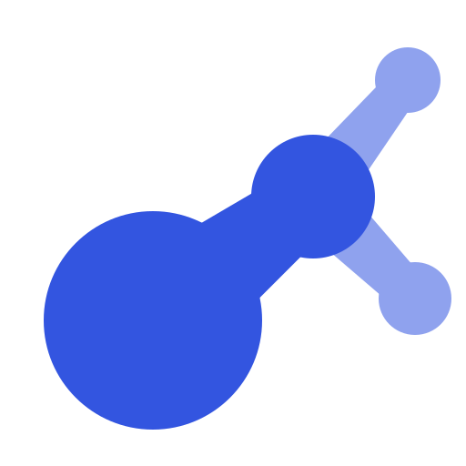
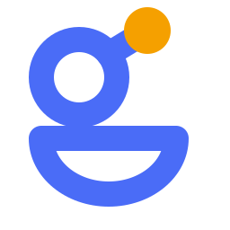
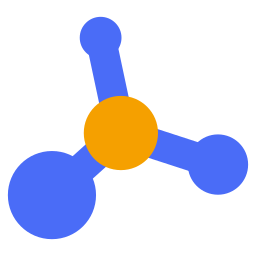
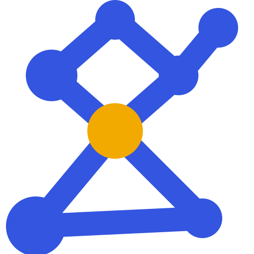

# Round 1: eight first concepts

- **The page as the owner saw it:** [index.html](index.html), which opens straight from this folder.
- **What the studio was asked to do:** [studio-brief.js](studio-brief.js), the brief the design team worked from.
- **What the studio asked and the owner answered:** [questions.md](../../questions.md#round-1-eight-first-concepts).
- **Everything else in this folder** is the round's complete output: every SVG and PNG, the scripts that drew them
  (how to rerun them: [GENERATORS.md](../GENERATORS.md)), and the round's notes and research.

A small design team (a graphic designer, an identity designer, a brand strategist and an outbound
marketer, with a director ranking their work) drew eight logo concepts by hand as SVG, from simple
geometry. Before drawing, each designer tried a few ideas with nanobanana (Google's Gemini image
model); those 11 images are in each designer's `explore/` folder, and none of them became a logo.
Each concept came with a mark on light and dark, a
one-color version, a lockup and a first try at a family of package icons. The team's research on
the field and on the target readers is in [research/](research/).

## The concepts

| Concept                                                                    | Idea                                                                                                                                | Director's view                                                                                                    |
| -------------------------------------------------------------------------- | ----------------------------------------------------------------------------------------------------------------------------------- | ------------------------------------------------------------------------------------------------------------------ |
| A, graph-g                           | A two-storey lowercase g built as a graph: the bowl and the loop are ring nodes joined by an edge; the ear is a third, amber node. | Ranked first. Cleanest g at 16 px; can read slightly as a female symbol or a key.                                  |
| B, loop-g                            | A g whose lower loop is a self-loop edge; every library is a cobalt tile with one white glyph and one amber node.                 | Best family system, but the pill-shaped loop reads as a snowman or a person in a tub.                              |
| C, depth                               | Four nodes on a leaning line, shrinking with distance: a graph drawn in perspective.                                               | Strongest non-letter shape at 16 px; can read as a matchstick, guitar or music note. Does not carry the name.      |
| D, depth-graph                   | One near node and three far nodes joined by tapered edges.                                                                         | Closest of all to Cytoscape's mark; a blob that reads as "R" or "k" at 16 px.                                       |
| E, binocular-g                  | A third g: ring node, cycle loop and an amber ear.                                                                                  | Weaker than A: the open bowl reads as a smile.                                                                     |
| F, perspective                  | Four nodes on a tilted plane, with a gap around the near amber node.                                                                | Reads as a price tag.                                                                                               |
| G, axis-node                      | A hub with edges along a cube corner.                                                                                               | Generic ball-and-stick, close to igraph and NetworkX.                                                              |
| H, cut-vertex                     | Two cycles sharing one gold cut vertex, as a g.                                                                                     | Reads as an hourglass or a stick figure; needs its own 16 px drawing.                                               |

The two leading concepts, with their lockups and first package icons:

The colors were indigo `#4f46e5` with amber `#f29d0b` (A, D), cobalt with amber (B) and blue with
gold (C).

## The owner's feedback

- **A**: creative; the combination of the g and the graph as one concept is liked. The package
  icons only partly work: the amber circle stops meaning anything in them, and their icons do not
  hang off the parent.
- **B**: rejected. The squashed loop is neither a g nor a graph.
- **C**: the depth is liked, as a differentiator, since graphty draws in 3D and most graph tools do
  not. Package lockups as "graphty" plus the package name in a second font are liked; the circle
  and line that tie C's family together are too weak, and its package icons are not thought
  through (format and layout both a grid of boxes, algorithms indistinguishable from layout,
  graph-io as arrows).
- **D**: okay, but uninspired. **E**: C's defects, worse.
- **F**: a contender; separating one node from the graph is a nice detail.
- **G**: a contender; it reads as a simple graph. **H**: reads as a graph, but too complex.
- **Color**: the indigo and amber pairing echoes the owner's WebAuthn logo, so it is liked, but
  other options were asked for.

## Decided

Take the g-as-a-graph idea (A), depth (C), the separated node (F) and the simple graph (G) into
round 2, and widen the palette search.
