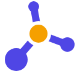
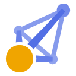
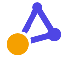
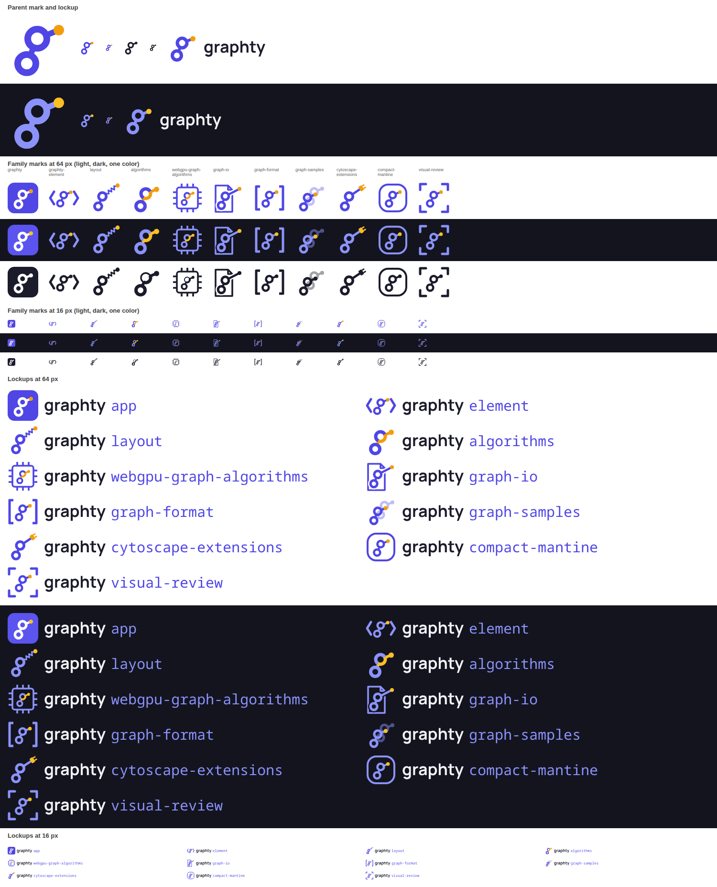
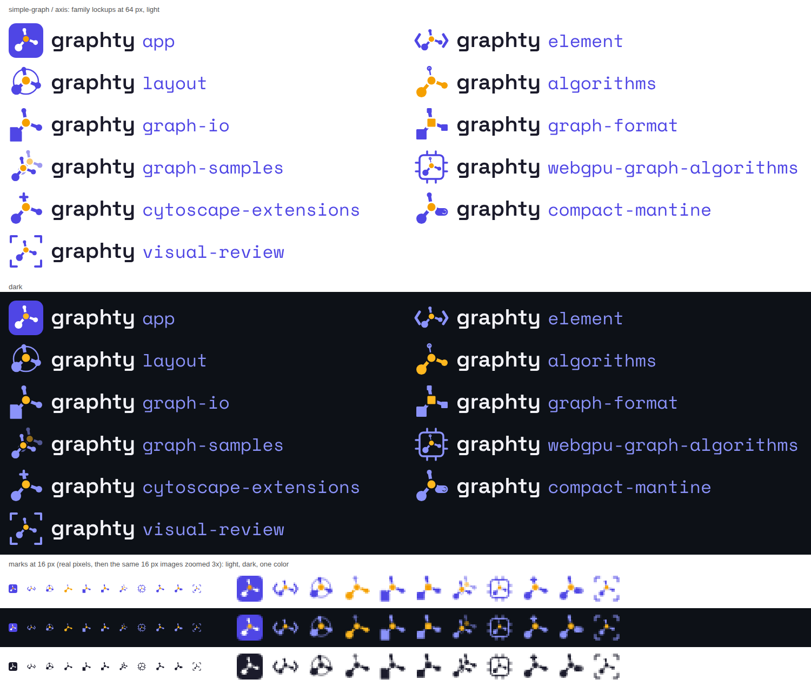

# Round 2: four directions, eight options, five palettes

- **The page as the owner saw it:** [index.html](index.html), which opens straight from this folder.
- **What the studio was asked to do:** [studio-brief.js](studio-brief.js), the brief the design team worked from.
- **What the studio asked and the owner answered:** [questions.md](../../questions.md#round-2-four-directions-two-versions-each).
- **Everything else in this folder** is the round's complete output: every SVG and PNG, the scripts that drew them
  (how to rerun them: [GENERATORS.md](../GENERATORS.md)), and the round's notes and research.

Round 2 took the four directions the owner liked in round 1 (the g as a graph, depth, the separated
node and the simple graph) and drew two options in each. Every family now kept the parent mark in
every package icon with one change, and every lockup was "graphty" plus the package name in a
second typeface. Five palettes were tried on the two leading marks.

## The options, in the director's order

| Option                                                                         | Idea                                                                                                     | Director's view                                                                                     |
| ------------------------------------------------------------------------------ | -------------------------------------------------------------------------------------------------------- | --------------------------------------------------------------------------------------------------- |
| 2A, g-graph zigzag                        | Round 1's A as a slanted g: the loop swings down-left, the ear flicks right to the amber focus node.     | Best family: every package icon is the exact parent g with one change. No 3D.                       |
| 2B, axis                               | An amber hub at a cube corner with edges along x, y and z, nodes shrinking with depth, a gap at the hub. | Clearest at 16 px, and the only one that says 3D there. Risk: a share or molecule icon.             |
| 2C, separated node, in front     | Two triangles sharing an edge, the big amber near node cut free in front.                                | Tightest family link, but the package changes are stock icons and the graph reads as a kite.        |
| 2D, depth pyramid                          | A four-node tetrahedron from a real 3D projection.                                                       | Best 3D at large sizes; a paper plane at 32 px and a smudge at 16 px.                                |
| 2E, triangle                       | The smallest cycle, with the amber node floating in front.                                               | Simple, but reads as a delta or an A.                                                               |
| 2F, separated node, pulled out  | A flat four-node graph; one edge stops short of the amber node, as if just dragged out.                  | Reads as an R or a bow-tie, and it is flat.                                                         |
| 2G, g-graph classic                      | An upright book-face g: a small bowl over a larger loop.                                                 | Reads as the digit 8 with a flag.                                                                   |
| 2H, depth ring-g                            | Six nodes on a tilted ring form the bowl; the stem swings toward the viewer.                             | Too busy: a robot, a lantern or a balloon before a g.                                               |

The two leading families, every package:

## Palettes

Each palette on 2A's lockup, light and dark:

| Palette                                               | Light                                                                     | Dark                                                                     |
| ----------------------------------------------------- | ------------------------------------------------------------------------- | ------------------------------------------------------------------------ |
| Indigo + amber (`#4f46e5`, `#f5a000`)                 |        |        |
| Deep teal + coral (`#0b6b70`, `#ec5a44`)              |          |          |
| Ink + electric lime (`#2a3045`, `#8fbf00`, `#c4f23a`) |            |            |
| Graphite + magenta (`#3a3f4b`, `#d61f69`)             |    |    |
| Two-blue depth (`#1e3a8a`, `#1d93cc`)                 |      |      |

Ink and lime was noted as the most distinctive (nobody in the field uses lime) but its lime fails
3:1 on white; graphite and magenta gave the strongest focus node at 16 px.

## The owner's feedback

- **2A**: the package icons are going the right way. Angle brackets for graphty-element, a chip
  for webgpu-graph-algorithms and a document page for graph-io are right. Algorithms and layout did
  not land; the ghosted copy for graph-samples "hurts my brain". visual-review and compact-mantine
  are not part of the graphty brand. For cytoscape-extensions, try "graphty + Cytoscape" or
  "graphty, a heart, Cytoscape".
- **2B**: the mark is liked, the font is not: the sharp corners of its g and y read like 1970s
  science fiction.
- **2C**: does not work; too complex, and the short edge reads as a dot and a diamond.
- **2D**: almost works; it needs more contrast between front and back, and a simpler back (two
  edges, not three).
- **2E**: the simple graph "really works"; the font still does not.
- **2F**: no. **2H**: ugly and complex, though the depth is liked.
- **2G**: show the three g drawings (round 1 and the two from round 2) side by side.
- **Color**: ink and lime, graphite and magenta, and indigo and amber are the top three. Research
  the psychology of color for the target readers for more options.
- **Fonts**: experiment next time; the lean is toward simple sans serifs like Amazon Ember.

## Decided

The g (2A) and the simple graph (2E) go on; the three g drawings are compared side by side; fonts
and color get their own studies.
