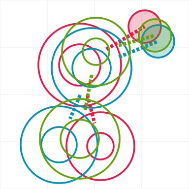
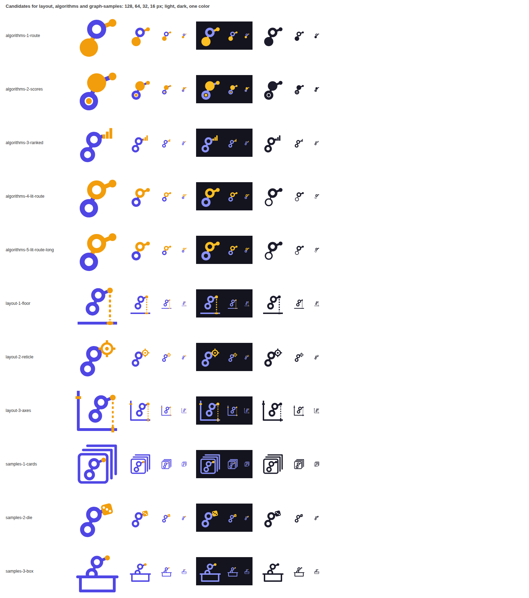
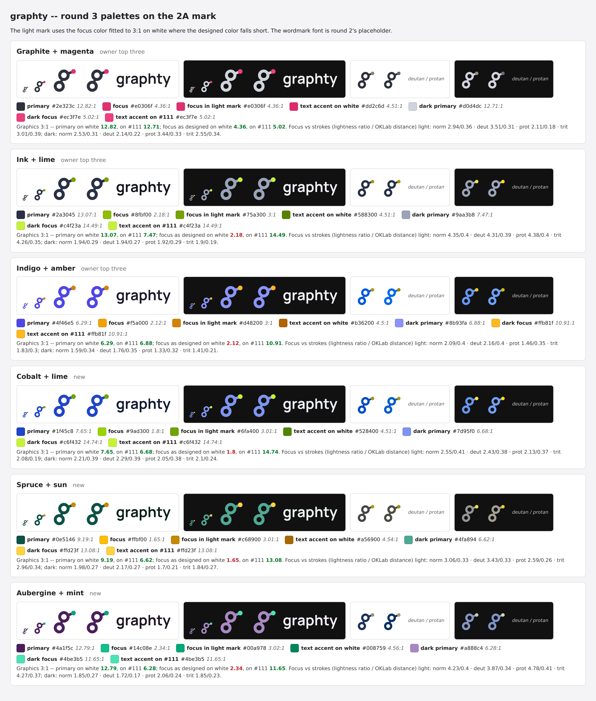
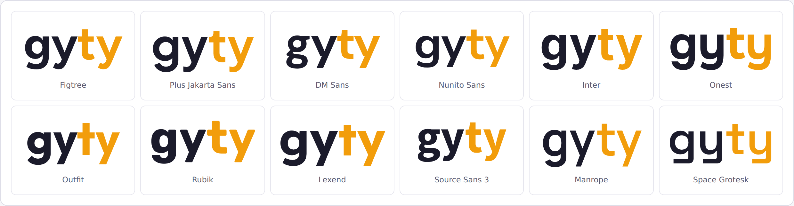
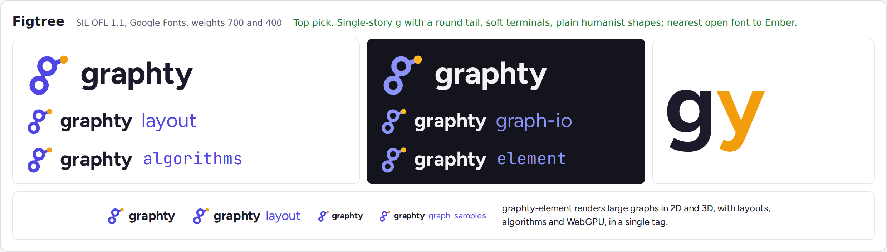
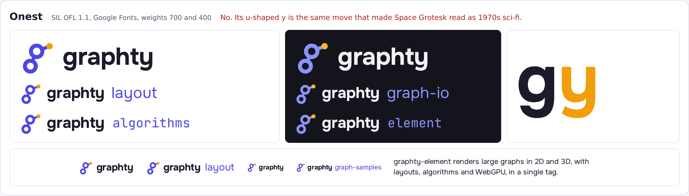
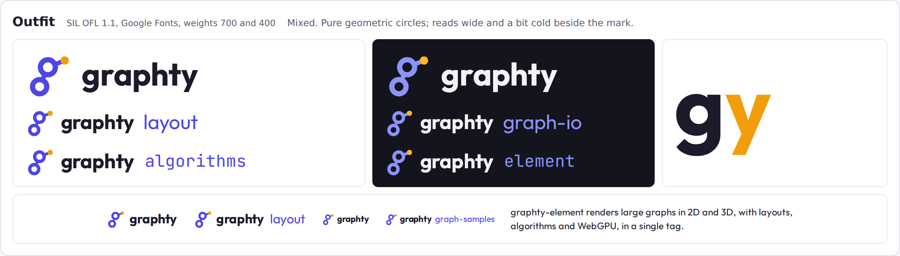
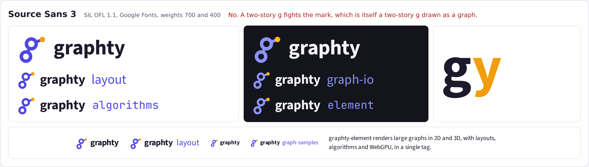
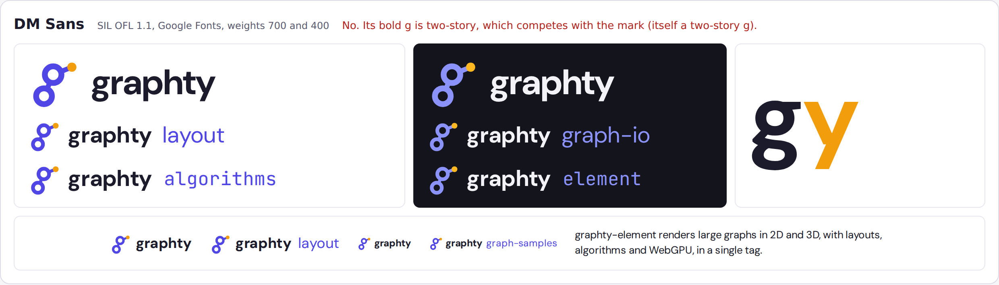

# Round 3: the g compared, families rebuilt, color and font studies

- **The page as the owner saw it:** [index.html](index.html), which opens straight from this folder.
- **What the studio was asked to do:** [studio-brief.js](studio-brief.js), the brief the design team worked from.
- **What the studio asked and the owner answered:** [questions.md](../../questions.md#round-3-the-g-shapes-side-by-side-palettes-and-fonts).
- **Everything else in this folder** is the round's complete output: every SVG and PNG, the scripts that drew them
  (how to rerun them: [GENERATORS.md](../GENERATORS.md)), and the round's notes and research.

Round 3 put the three g drawings side by side with a proposed best-of g, rebuilt the 2A family,
refined the depth pyramid and the triangle with their families, drew the first Cytoscape
co-brands, and ran a color study and a font study. Every choice carried a label so the owner
could reply with picks.

## The three g drawings and a best-of

All four are the same drawing: a top ring (bowl), a bottom ring (loop), an edge between them, and
an ear edge out to the amber node. Only sizes and positions change.

| Round 1 A                          | Round 2 2A, zigzag (3B)                | Round 2 2G, classic                     | Best-of proposal (3D)                |
| ---------------------------------- | -------------------------------------- | --------------------------------------- | ------------------------------------ |
|  |  |  |  |
| Bowl bigger than the loop; at 16 px the loop hole closes. | Equal rings, the loop swings far left; at 16 px the rings touch. | Loop bigger than the bowl, nearly stacked: reads as an 8. | Equal rings, a steadier swing, a visible edge between the rings, a steeper ear. |

The outlines on one grid: 

## The 2A family, rebuilt (3E)

Kept from round 2: angle brackets for graphty-element, the chip for webgpu-graph-algorithms, the
page for graph-io, square brackets for graph-format. New: layout puts the g on x/y axes, algorithms
lights the route an algorithm found, graph-samples turns the amber node into a die. Nothing is
ghosted; visual-review and compact-mantine are out of the brand.

## Cytoscape co-brands

Each uses the Cytoscape.js logo unaltered (the extensions plug into Cytoscape.js, so it is the .js
logo, not the desktop app's orange one).

| graphty + Cytoscape.js (C1)       | graphty, heart, Cytoscape.js (C2)  | "graphty extensions for Cytoscape.js" (C3) |
| --------------------------------- | ---------------------------------- | ------------------------------------------ |
|  |  |  |

## Depth and the triangle, refined

| 2D pyramid, two back edges (3F)        | 2E triangle (3G)                         | Triangle with depth (3H)              |
| -------------------------------------- | ---------------------------------------- | ------------------------------------- |
|    |     |     |

## Color study

Six palettes, each a dark muted primary for credibility and one saturated focus node, checked for
contrast and for color-blind readers. The research (with citations) is in
[research/color-notes.md](research/color-notes.md). In short: lightness and saturation matter more
than hue; blue against yellow is the color-blind-safe axis; the field has taken orange (Cytoscape),
blue (Neo4j, Linkurious), red (igraph, sigma.js), teal (Graphistry) and lilac (KeyLines), leaving
magenta, lime, plum and deep green free.

## Font study

Ten open-licensed sans serifs (SIL Open Font License 1.1) toward a "simple sans like Amazon Ember":
Figtree, Nunito Sans, Plus Jakarta Sans, DM Sans, Source Sans 3, Inter, Onest, Outfit, Rubik and
Lexend. Every g and y side by side:

| Figtree                      | Onest                      | Outfit                      | Source Sans 3                      | DM Sans                      |
| ---------------------------- | -------------------------- | --------------------------- | ---------------------------------- | ---------------------------- |
|    |    |    |    |    |

The team recommended the rebuilt family on the best-of g, the heart co-brand, ink and lime, and
Figtree, with the triangle with depth as runner-up.

## The owner's feedback

- **3B** (round 2's zigzag g) is the best of the g drawings.
- graph-samples as cards works; layout and algorithms need more ideas.
- **3F** and **3H** read as spaceships. **3G** (the triangle) still has potential.
- A lost candidate should come back: four nodes and three edges with a node in the middle.
- The co-brand should be just the two logos followed by "graphty cytoscape-extensions".
- **Color**: still the three pairs picked before (ink and lime, graphite and magenta, indigo and
  amber).
- **Fonts**: Figtree, Onest and Outfit are liked; the looping g of Source Sans 3 and DM Sans could
  echo the mark. Is there a font with a looping g and otherwise simple letters?
- Write down criteria for choosing, test the marks on simulated readers, make color and font
  variations of the liked marks, and lock a winner.

## Decided

The g follows 3B. Round 4 judges the candidates against written criteria and reader panels.
