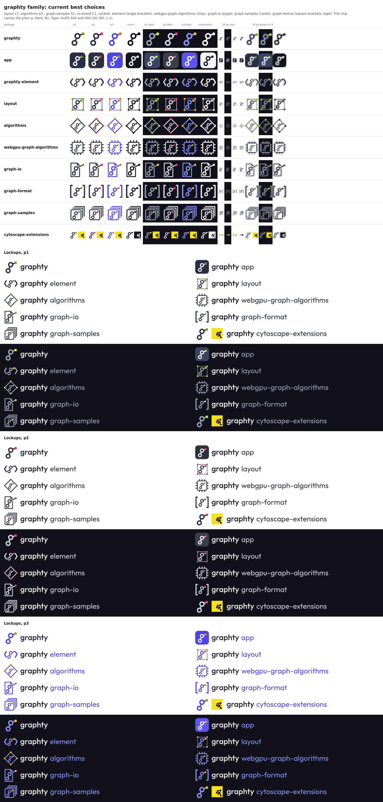
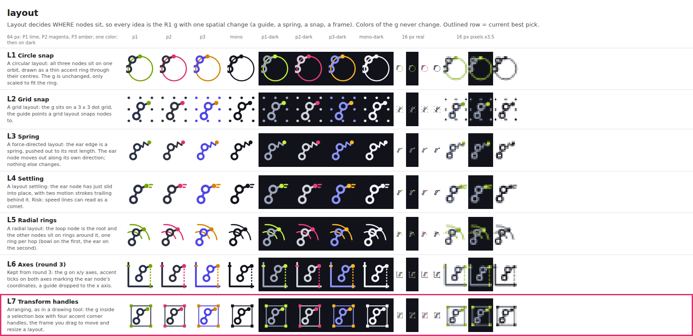
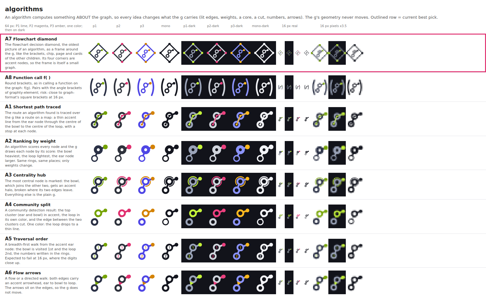
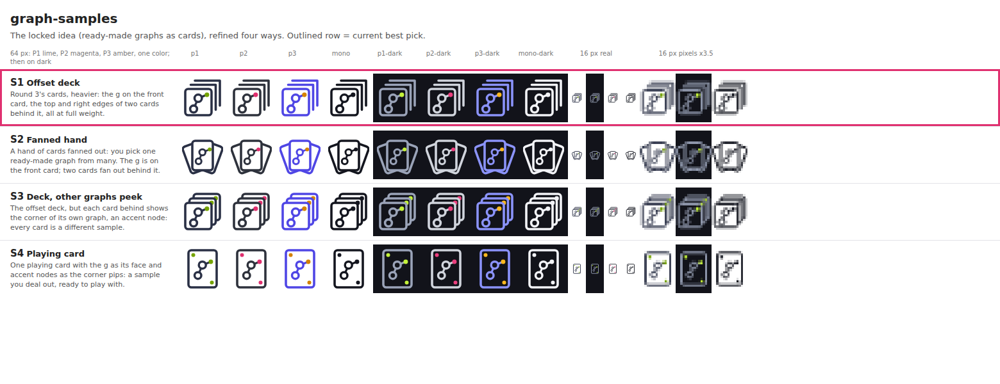
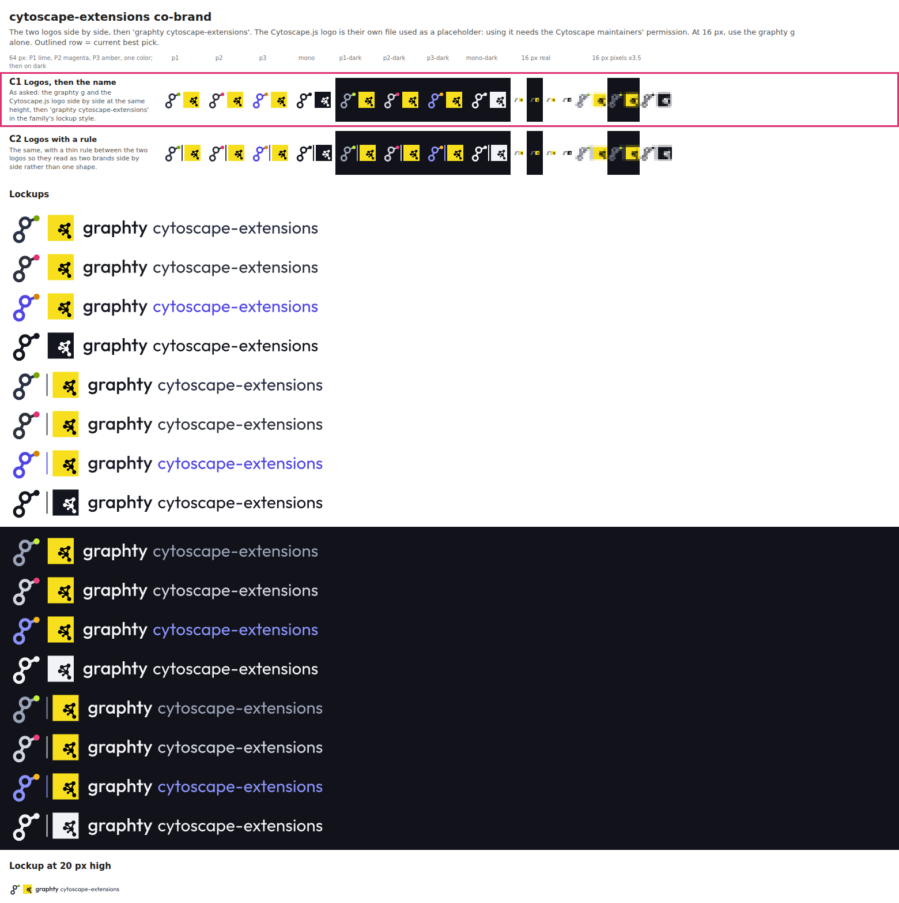
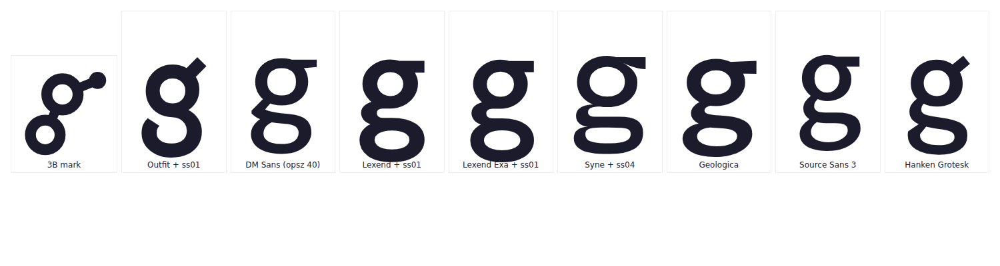

# Round 4: criteria, reader panels and a winner

- **The page as the owner saw it:** [index.html](index.html), which opens straight from this folder.
- **What the studio was asked to do:** [studio-brief.js](studio-brief.js), the brief the design team worked from.
- **What the studio asked and the owner answered:** [questions.md](../../questions.md#round-4-criteria-reader-panels-and-a-winner).
- **Everything else in this folder** is the round's complete output: every SVG and PNG, the scripts that drew them
  (how to rerun them: [GENERATORS.md](../GENERATORS.md)), and the round's notes and research.

Round 4 judged the candidates against written criteria, tested them on simulated readers, opened
the 3B g up so it survives at 16 px, and built a full kit around the winner. The criteria and
their tests are in [research/criteria.md](research/criteria.md).

## How the candidates were judged

Two gates, then nine weighted criteria scored 0 to 4, for a maximum of 400:

- **No unintended reading**: a mark fails when two or more readers name the same non-graph object
  as the first thing they see.
- **Readable at 16 px**: a mark fails when two parts merge or a hole closes at 16 px.

| Criterion                                                                         | Weight |
| --------------------------------------------------------------------------------- | -----: |
| Reads as a graph and carries the name                                             |     18 |
| Recognizable small (favicon, npm, GitHub avatar)                                  |     15 |
| Distinct from the field (Cytoscape, Neo4j, Gephi, D3, NetworkX, molecule icons)   |     12 |
| The family scales to every package                                                |     12 |
| Works in one color and in dark mode                                               |     10 |
| Says something true about graphty                                                 |      9 |
| Works in every place it will appear                                               |      9 |
| Ages well (no gradients, glows or trends)                                         |      7 |
| The owner's affinity, from his notes                                              |      8 |

A blind panel of six simulated readers (a front-end developer, a data scientist, a
bioinformatician, a brand designer, a conference attendee and a non-technical manager) saw each
mark anonymously, in shuffled order, and was asked "What is this a picture of?" and "Do you see
any letters?".

## Results

| Mark                                         | Total | What the readers said                                                                                                   |
| -------------------------------------------- | ----: | ----------------------------------------------------------------------------------------------------------------------- |
| R1, 3B opened up  | 328 | 6 of 6 named connected nodes first; second readings were molecule, git branch and share icon. Rings stay apart at 16 px. |
| R2, R1 with a steeper ear  | 316 | The bigger dot made an earlier panel's male-symbol reading stronger.                                                   |
| E4, R1 with a flat ear         | 302 | Best letter read (5 of 6 saw a g), but 5 of 6 named the male symbol second. Rejected.                                   |
| G1, the heavier triangle   | 296 | 6 of 6 saw a triangle network, 5 of 6 then the phone's share icon. Runner-up.                                            |
| 3B as drawn       | fail | The rings fuse into an 8 at 16 px; R1 is the fix.                                                                      |
| G5, hub bent into a y      | fail | A Y or a slingshot to every reader.                                                                                     |
| G6, hub with depth         | fail | A stick figure at small sizes.                                                                                          |

R1 is 3B with rings 6 units wide instead of 7, both rings half a unit smaller and the lower ring
moved down and left: the gap between the rings grows from 1.7 to 6 units out of 64. The flatter
ears tried to answer the male-symbol worry (E1 to E5) made it worse in the blind panel, so the
diagonal ear stayed.

## The winner's kit

Recommended: R1 in graphite and magenta, the wordmark in Outfit 500, and a family of frames:
brackets, chip, page, square brackets, cards, a selection box for layout (L7) and a flowchart
diamond for algorithms (A7).

The options for layout, algorithms and graph-samples, and the co-brand:

## Wordmark and fonts

R1 lockups with three palettes and six fonts (V1 to V18) are in
[3B-variations/lockups/](3B-variations/lockups/). The font research checked about 95
open-licensed families for a looping g with otherwise plain letters, and found it inside Outfit:
stylistic set 1 (`ss01`) swaps in a looping g with a diagonal ear and near-round rings.

| Outfit 500, plain g (V9)                                         | Outfit 500, `ss01` (V12)                                              |
| ---------------------------------------------------------------- | --------------------------------------------------------------------- |
|   |  |

## The owner's feedback

- The winner is R1. Show three versions with a different circle colored (the ear node, the middle
  ring, the bottom ring): would coloring a ring look more like a graph and still keep the g?
- The wordmark is V12, Outfit with `ss01`.
- Layout is L7. Algorithms is A1 (the shortest path traced), A3 (the centrality halo) or a
  combination: show the options.
- graph-samples is the stack of cards, without the dots on the back cards (S3 minus its dots).
- Cytoscape co-brand: graphty logo, plus sign, Cytoscape logo; or graphty logo, heart, Cytoscape
  logo. Show both.
- The flat ears E1 to E5 are not keepers; keep the mark as it is.
- Color is still open: show every wordmark, lockup and package logo in all three palettes, with
  the team's pros and cons. The three magentas look the same: is more than one accent needed?
