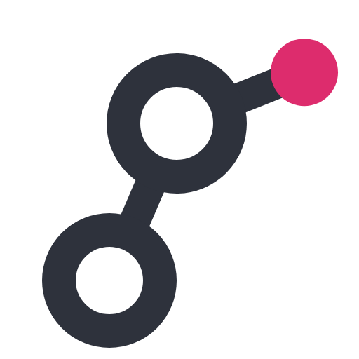
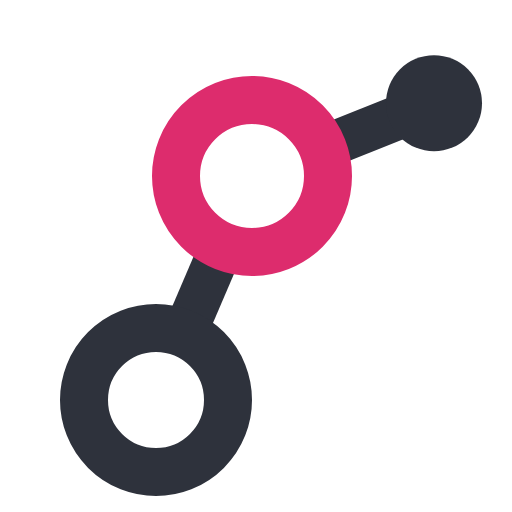
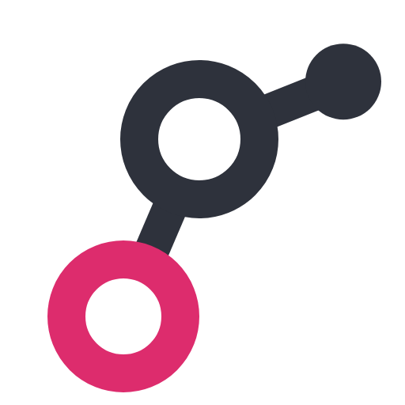
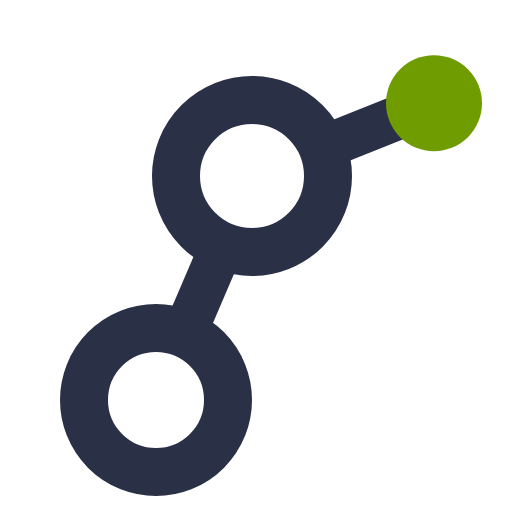
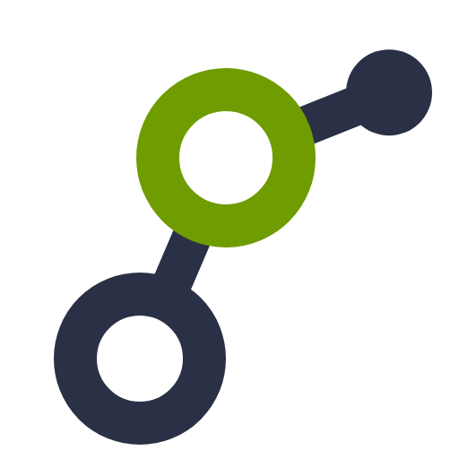
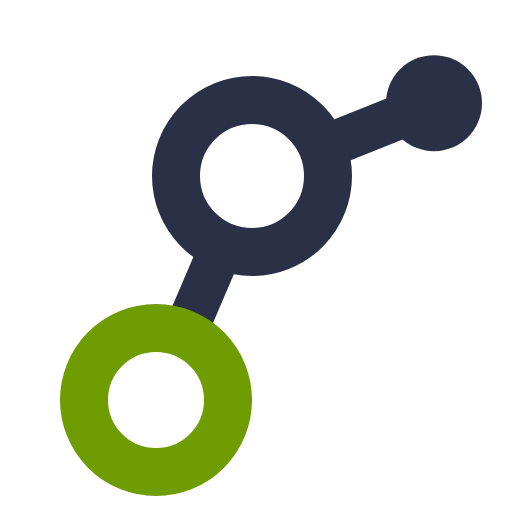

# Round 5: the colored circle, algorithms, the co-brand and one accent

- **The page as the owner saw it:** [index.html](index.html), which opens straight from this folder.
- **What the studio was asked to do:** [studio-brief.txt](studio-brief.txt), the brief the design team worked from.
- **What the studio asked and the owner answered:** [questions.md](../../questions.md#round-5-circle-algorithms-samples-co-brand-accents).
- **Everything else in this folder** is the round's complete output: every SVG and PNG, the scripts that drew them
  (how to rerun them: [GENERATORS.md](../GENERATORS.md)), and the round's notes and research.

Round 5 confirmed the wordmark, showed the mark with each of its three circles carrying the color,
offered five algorithms marks, cleaned up graph-samples, drew the plus and heart co-brands, and
asked how many accent colors a palette needs. Every option was shown in all three palettes.

## Wordmark: Outfit 500 with `ss01`

Confirmed. `ss01` changes two letters of "graphty", not one: the g's tail curls deeper, and the t
gets a curved foot. Package names stay in plain Outfit 400, because `ss01` would also change their
e, n, m and t.

| Plain Outfit                       | Outfit with `ss01`                |
| ---------------------------------- | --------------------------------- |
|  |  |

## Which circle carries the color

| The ear node (N1)                         | The middle ring (N2)                       | The bottom ring (N3)                       |
| ----------------------------------------- | ------------------------------------------ | ------------------------------------------ |
|  |  |  |
|     |     |     |

The team kept N1: the color sits on the one part that is only a node and not part of the letter,
so the g stays whole. N2 reads slightly more like a network and keeps more color at 16 px, but the
colored ring splits the letter; N3 makes the mark bottom-heavy.

## Algorithms

| A1, path traced                                     | A3, centrality halo                                 | A1 + A3, both whole                                    | Halo and a stop, no route                              | Route into the hub                                     |
| --------------------------------------------------- | --------------------------------------------------- | ------------------------------------------------------ | ------------------------------------------------------ | ------------------------------------------------------ |
|     |     |     |     |     |

The team picked the route into the hub; A1 alone is the most legible at 16 px.

## graph-samples

| The stack with dots on the back cards (S3)    | No dots (S3a)                                            | Only the rearmost dot removed (S3b)                      |
| --------------------------------------------- | -------------------------------------------------------- | -------------------------------------------------------- |
|          |      |      |

## The Cytoscape co-brand: plus or heart

| Plus (K1)                               | Heart (K2)                               |
| --------------------------------------- | ---------------------------------------- |
|    |     |

The Cytoscape.js logo is set at about 90% of the g's height and centered on the g's visual
center, because a filled square looks bigger than an open g at the same height.

## One accent per palette

A brand defines one accent and one logo value of it; tonal steps for text belong to the product's
UI color scale. No single color reaches 4.5:1 on both white and `#111111` (the best possible is
4.35:1), which is why round 4's three magentas looked identical: they all sat on that edge. One
value per palette was recommended: graphite and magenta `#dd2c6d`, ink and lime `#6f9c00`, indigo
and amber `#c97c00`.

The team's palette notes: magenta is unclaimed in graph visualization and works on white and dark
at one value, but is loud in large fills. Lime is energetic and technical, but cannot be text on
white without turning olive and sits near NVIDIA green. Amber with indigo is the color-blind-safe
pair, but amber crowds Cytoscape's orange and yellow, and indigo `#4f46e5` is Tailwind's default.

## The owner's feedback

- Wordmark V12 (Outfit 500, `ss01`).
- Show each circle treatment both with the wordmark and alone.
- Algorithms: A1 + A3, both whole (the traced path and the halo on the bowl).
- graph-samples: S3a.
- Co-brand: the heart (K2).
- Package names in lockups are in the accent color; "graphty" always stays in the dark color.
  Regenerate the palette sheets with that coloring.
