# Round 7: bright green, pink, and the app

- **The page as the owner saw it:** [index.html](index.html), which opens straight from this folder.
- **What the studio was asked to do:** [studio-brief.txt](studio-brief.txt), the brief the design team worked from.
- **What the studio asked and the owner answered:** [questions.md](../../questions.md#round-7-bright-green-pink-and-the-real-app).
- **Everything else in this folder** is the round's complete output: every SVG and PNG, the scripts that drew them
  (how to rerun them: [GENERATORS.md](../GENERATORS.md)), and the round's notes and research.

Round 7 went back to round 3's bright lime `#c4f23a`, built a green scale around it, compared
ways to show the mark's node on white, and rebuilt the real graphty app (Les Miserables loaded,
Louvain community detection run) with each candidate accent. The pink and green palettes each got
a full brand palette.

## The green scale

Bright lime is a very light color: superb on dark, nearly invisible on white. Four values, each
with one job:

| Name       | Value     | Job                                                         | On white | On `#111111` |
| ---------- | --------- | ----------------------------------------------------------- | -------: | -----------: |
| lime       | `#c4f23a` | the brand green on dark: the node, the app accent, accents  |    1.3:1 |      14.49:1 |
| lime 500   | `#75a300` | graphics on white: icons, chart marks                       |      3:1 |       6.29:1 |
| lime 700   | `#588300` | text on white: links, filled buttons with white labels      |   4.51:1 |       4.19:1 |
| lime 50    | `#f1fbd3` | selection tint in the light theme                           |   1.08:1 |      17.52:1 |

## The mark's node on white

| Bright node, thin ink outline (G-W1)    | Lime 500 node (G-W2)                    | Round 2's `#8fbf00` (G-W4)               | On dark                                 |
| --------------------------------------- | --------------------------------------- | ---------------------------------------- | --------------------------------------- |
|  |  |  |  |
|   |   |   |   |

A fourth answer (G-W3) put the mark on the dark app-icon tile wherever the background is white.

## The real app in each accent

Figma's plugin tokens define one "brand" accent token that each product sets to its own color
(https://developers.figma.com/docs/plugins/css-variables/), and the graphty app's theme already
works the same way, so each screen below changes only that one color.

| Accent                                    | Dark theme, workspace            | Light theme, workspace                 |
| ----------------------------------------- | -------------------------------- | -------------------------------------- |
| Today (Figma blue)                        | 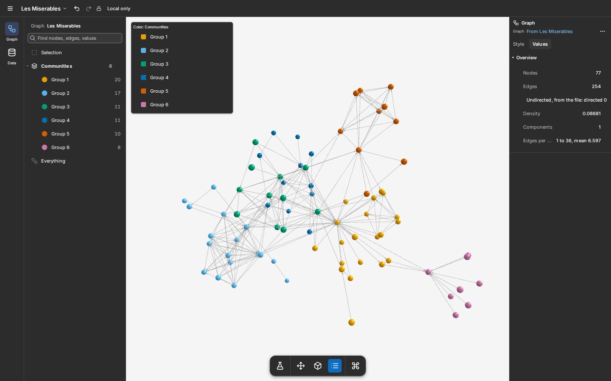    | 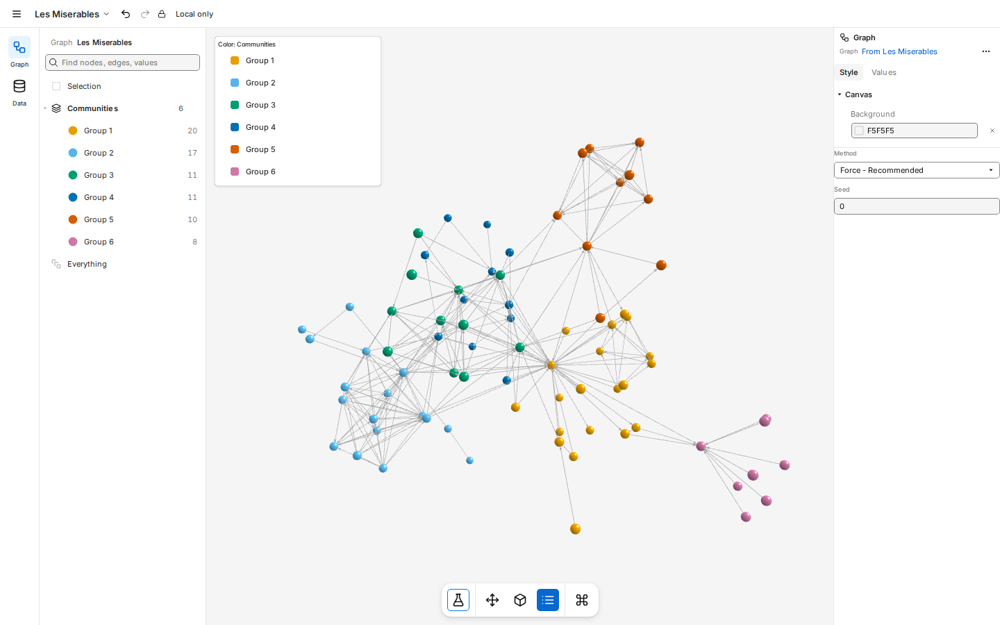    |
| Magenta forward (PK-A)                    | 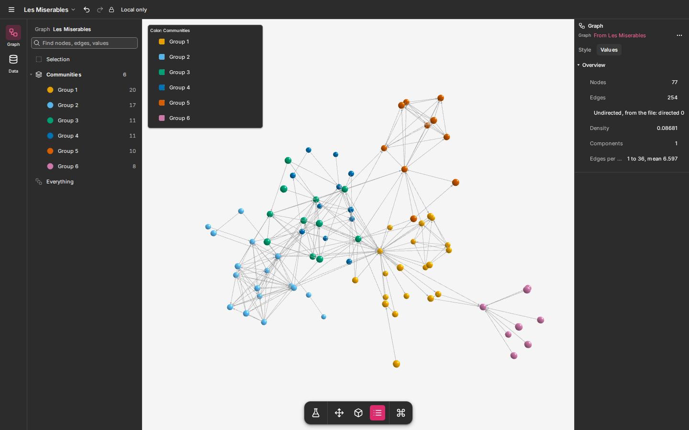    | 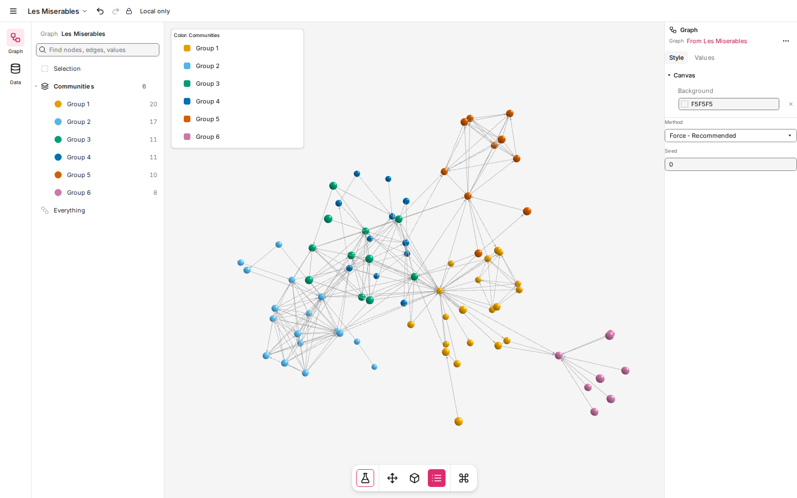    |
| Berry UI, magenta brand (PK-B)            | 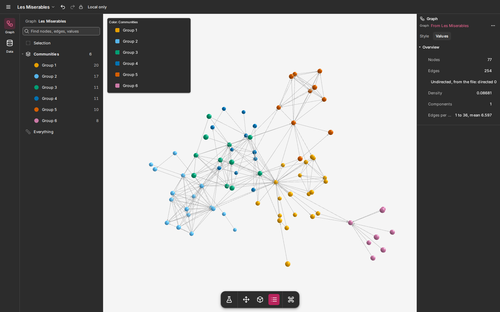    | 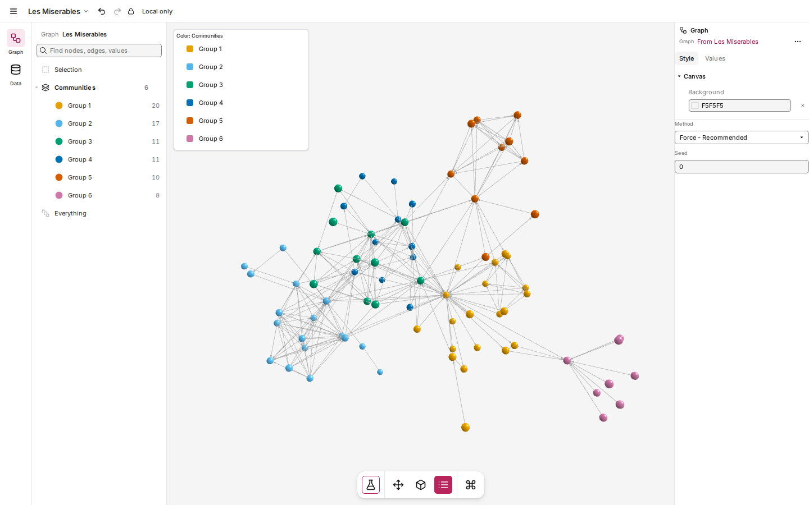    |
| Indigo UI, magenta brand (PK-C)           | 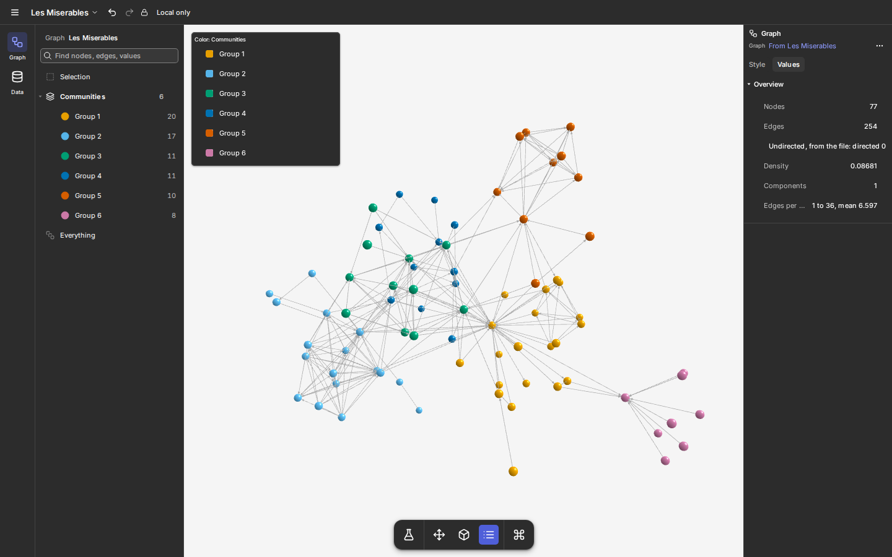    | 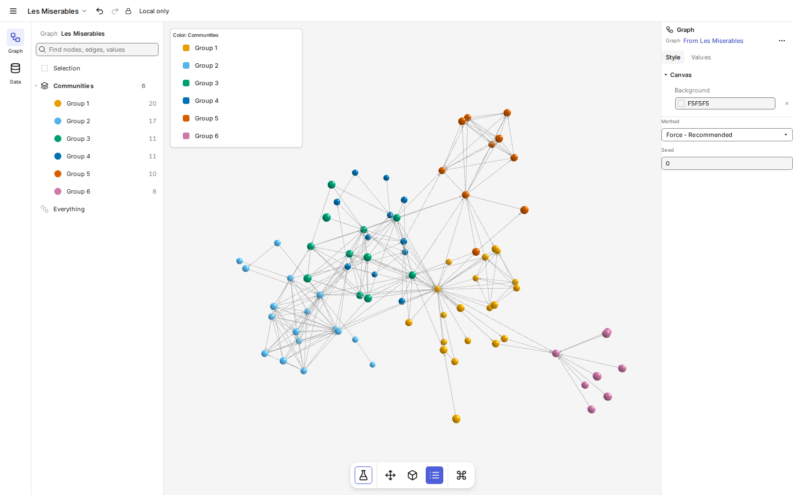    |
| Raw lime, white labels (GR-A)             |     | 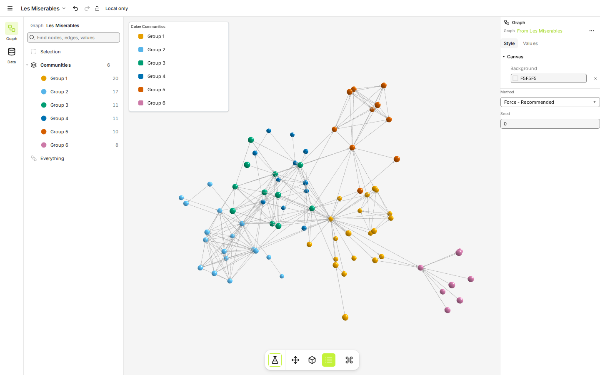    |
| Lime with dark labels (GR-B)              | 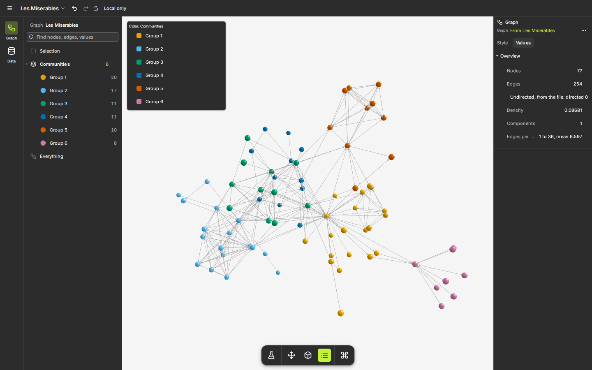    |     |
| Teal UI, lime brand (GR-C)                | 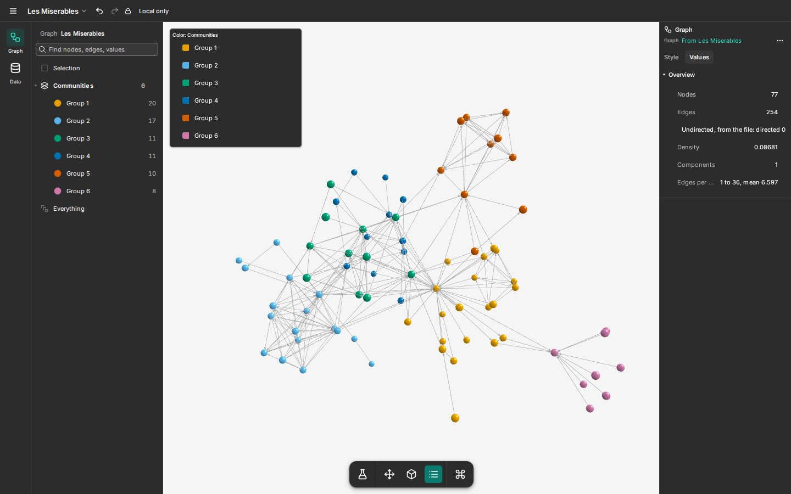    | 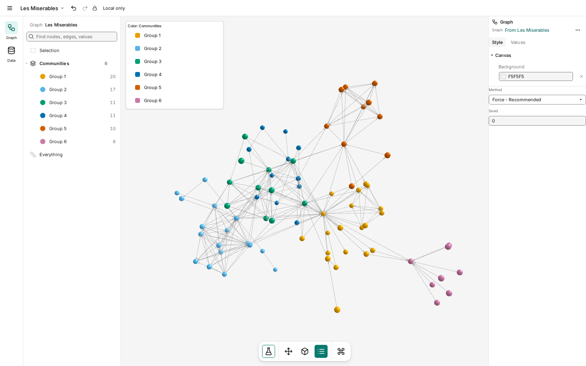    |
| Lime with dark labels, `#8fbf00` graphics (GR-D) |                           | 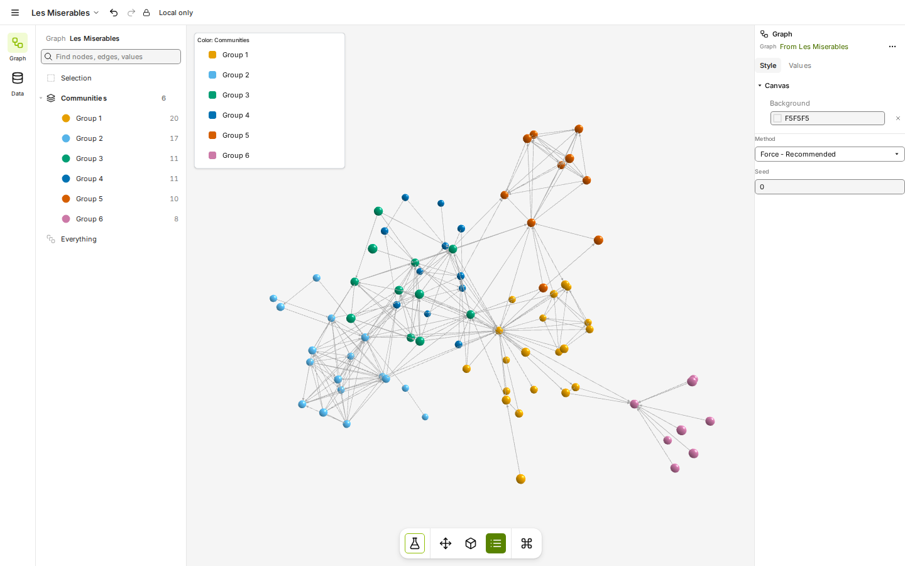    |

Every screen (start, workspace, style panel, a popover, the Analyze menu, settings, in both
themes) is in [app/](app/). What the app showed: white labels on lime are unreadable (1.3:1), so
lime needs dark labels; magenta works as the app accent as it is; an accent in the graph's own
community colors can look like "another group", so canvas selection must not rely on the accent
alone.

## The team's recommendation

For pink, PK-A: one magenta for logo and app. For green, GR-B: bright lime with dark labels on
dark, the olive `#588300` in the light theme, and the outlined node (G-W1) on white. Pink is the
simpler system; green is the more distinctive.

## The owner's feedback

- Lime and ink. Use `#8fbf00` (G-W4) for the node on white, and look at brighter greens, up to
  the same green as on black.
- The heart in the co-brand must be pink or red.
- The circle is still open: show the whole kit (marks, lockups, package logos) with each circle
  treatment.
