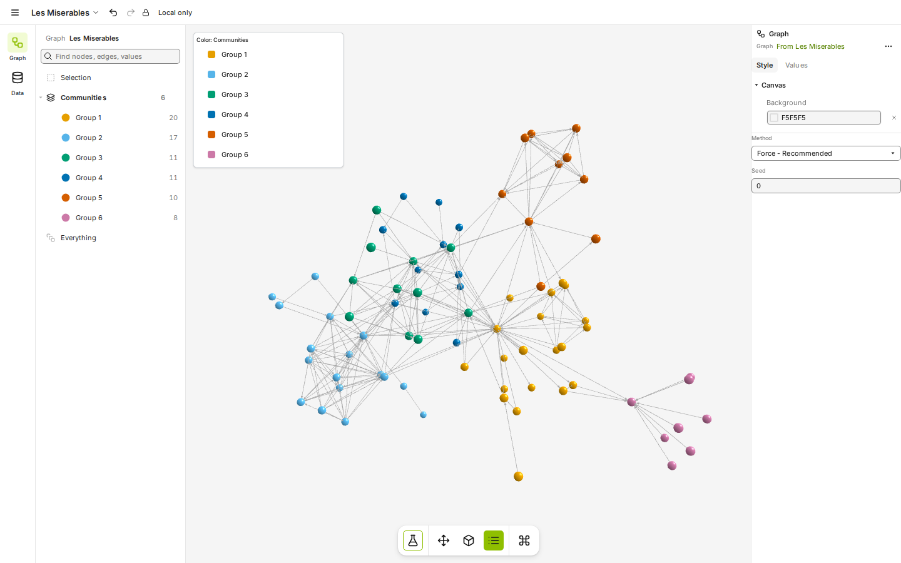
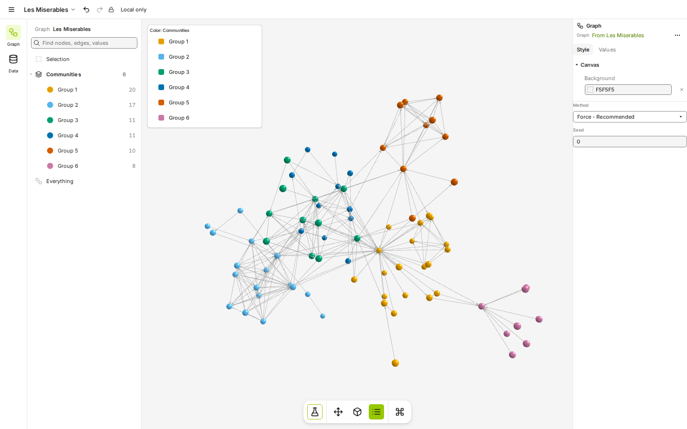
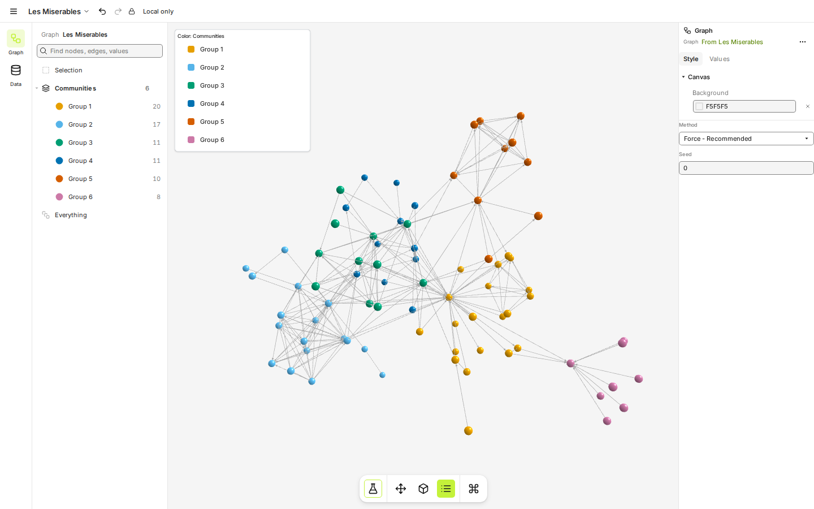

# Round 8: how bright on white, the heart, and the circle

- **The page as the owner saw it:** [index.html](index.html), which opens straight from this folder.
- **What the studio was asked to do:** [studio-brief.txt](studio-brief.txt), the brief the design team worked from.
- **What the studio asked and the owner answered:** [questions.md](../../questions.md#round-8-how-bright-on-white-the-heart-and-the-circle).
- **Everything else in this folder** is the round's complete output: every SVG and PNG, the scripts that drew them
  (how to rerun them: [GENERATORS.md](../GENERATORS.md)), and the round's notes and research.

With lime and ink settled, round 8 asked three last questions: how bright the node's green can be
on white, which red or pink the co-brand heart is, and which circle carries the color. On dark the
green is always the bright lime `#c4f23a`.

## Brighter greens on white

| Green                  | On white | On black | The mark on white                     | The mark on dark                     |
| ---------------------- | -------: | -------: | ------------------------------------- | ------------------------------------ |
| G-W4 `#8fbf00`         |   2.18:1 |   9.62:1 |  |  |
| G-W5 `#97c800`         |   1.99:1 |  10.58:1 |  |  |
| G-W6 `#a2d400`         |   1.76:1 |  11.95:1 |  |  |
| G-W7 `#aedf10`         |   1.57:1 |  13.36:1 |  |  |
| G-W8 `#b8e826`         |   1.44:1 |  14.61:1 |  |  |
| G-W9 `#c4f23a`         |    1.3:1 |  16.11:1 |  |  |

Going brighter buys energy at the cost of the node on white. `#97c800` is the safe "a bit
brighter"; from `#aedf10` up the ink rings carry the mark and the node turns into a pale fleck.
The real 16 and 32 px renders are in [png/mark/](png/mark/).

Each green as the light theme's accent in the real app (filled buttons with dark labels, the
active tool, icons, selection edges; links stay `#588300`):

| `#8fbf00`                               | `#97c800`                               | `#c4f23a`                               |
| --------------------------------------- | --------------------------------------- | --------------------------------------- |
|  |  |  |

The dark theme is the same for every option; it and the other screens are in [app/](app/).

## The heart

| Rose red `#e8304f` (H1)                     | Hot pink `#ff4f8b` (H2)                      | True red `#e02424` (H3)                      |
| ------------------------------------------- | -------------------------------------------- | -------------------------------------------- |
|          |           |           |
| 4.23:1 on white; between red and pink, a near complement of lime | 3.11:1 on white; friendliest, closest to the old pink | 4.72:1 on white; can read as an error color in an app |

## The circle

| The ear node (N1)                        | The middle ring (N2)                     | The bottom ring (N3)                     |
| ---------------------------------------- | ---------------------------------------- | ---------------------------------------- |
|      |      |      |
|       |       |       |

With lime the choice matters more: N1 colors one small solid dot, so a light green costs little;
N2 and N3 color a whole ring, which goes pale on white and loses part of the letter. Every package
logo with each treatment is in [svg/mark/](svg/mark/).

## The owner's decisions

- The node on white is `#97c800` (G-W5), on the top-right node, as a plain solid fill (N1).
- The heart is rose red `#e8304f` (H1).
- Check what Cytoscape's published terms say about using their logo; do not email the maintainers.
- Build the full brand kit and a brand guide.

When the kit was reviewed, the owner also decided:

- The kit covers only graphty's published packages: the graphty app, compact-mantine,
  visual-review and remote-logger have no package brand.
- The co-brand comes in color only, because Cytoscape.js publishes no one-color logo.
- Package names on white use the mark's green `#97c800`, not the olive text green, so the name and
  the node match.
- The brand kit goes in its own repository, graphty-org/brand, with this design record beside it.
